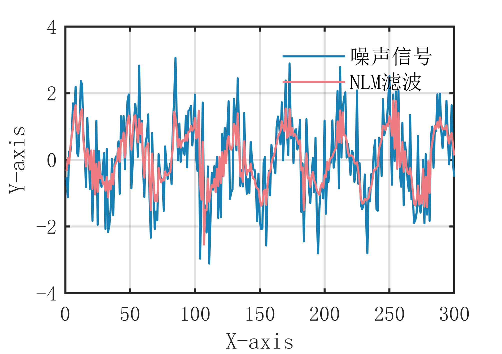

# MATLAB | Digital Signal Processing | One-Dimensional Signal NLM Nonlocal Mean Filtering Algorithm | Includes data and plotting code | Directly Useable

1. Basic Definition
The one-dimensional signal NLM non-local mean filtering algorithm is a filtering method based on the idea of non-local means. It processes the signal by dividing it into blocks, calculates the similarity between each block and other blocks, and removes noise using non-local means. The main idea of this algorithm is to find blocks similar to the current block within a certain range, using their non-local means as an estimate for the current block, thereby achieving noise removal. Specifically, the steps of the one-dimensional signal NLM non-local mean filtering algorithm are as follows:
Divide the signal into multiple blocks, with each block having a size of w.
Calculate the similarity between each block and other blocks, and select blocks similar to the current block based on this similarity.
Calculate the non-local means of the selected blocks.
Use these non-local means as estimates for the current block to remove noise. The advantage of the one-dimensional signal NLM non-local mean filtering algorithm is that it can remove noise to some extent while preserving the edges and detail features of the signal. However, it requires calculating a large number of similarities, has high algorithm complexity, and needs to choose appropriate window sizes and block sizes to achieve optimal filtering effects. Additionally, this algorithm may perform poorly in cases where the signal has rapid changes and significant noise.
2. Definition and Outline Effects
The outline effect is as follows:
\n        \n  
Outline video tutorial operation:
\n        \n          \n          \n          \n          \n            To view this video please enable JavaScript, and consider upgrading to a\n            web browser that\n            supports HTML5 video\n

## Images

<!-- PAYMENT_BLOCK -->

## Get this dataset

- Payment link (Stripe): [Buy now](https://buy.stripe.com/3cs8yP7sY87d0vu9AB)
- Payment QR code: 

<!-- /PAYMENT_BLOCK -->
